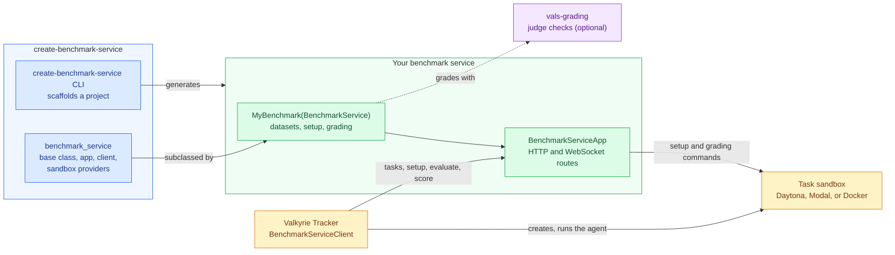

# create-benchmark-service

A benchmark service is the web service [Valkyrie](../../README.md) calls to list a benchmark's tasks, set each one up in a sandbox, and grade what the agent did. This package is the framework those services are built on (`benchmark_service`), plus a CLI that scaffolds a new one.

## How it fits together

You write one `BenchmarkService` subclass that knows your datasets and your grader. The framework turns it into the HTTP and WebSocket API that Valkyrie's Tracker speaks, so nothing on the Valkyrie side needs to know about your benchmark.



[vals-grading](../vals-grading/README.md) is a separate package for judge-model checks that a service can grade with.

## Install

```bash
uv tool install "git+https://github.com/vals-ai/Valkyrie.git@prod#subdirectory=packages/create-benchmark-service"
```

- The base install includes Daytona, Modal, and the OpenTelemetry API.
- The `vals-ai` extra (`create-benchmark-service[vals-ai]`) adds the AWS clients and Sentry that artifact grading, evaluation resume storage, and error reporting use.

## Create a service

```bash
create-benchmark-service <benchmark-name>
```

This writes a new project to `./<benchmark-name>-benchmark-service/`:

```
<benchmark-name>-benchmark-service/
├── main.py                        # Serves your class with BenchmarkServiceApp
├── src/{benchmark_package}/
│   └── benchmark_service.py       # The BenchmarkService subclass you fill in
├── tests/
├── .github/workflows/             # Test, lint, typecheck, PR title, and release tagging
├── pyproject.toml                 # Pins the framework version that generated it
├── Dockerfile
└── Makefile
```

The Valkyrie guide to [converting a benchmark](https://docs.valkyrie.vals.ai/benchmarks/convert-a-benchmark) walks through filling in the generated class one method at a time, and [Service API](docs/SERVICE_API.md) is the reference for each method.

## Read next

| Page | What it covers |
| --- | --- |
| [Service API](docs/SERVICE_API.md) | The methods you implement, the routes the app serves, the streaming protocol, and the schemas |
| [Grading](docs/GRADING.md) | Grading credentials, the judge models a task needs, and retrying grading without rerunning the agent |
| [Sandboxes](docs/SANDBOXES.md) | Choosing a provider per request, how providers differ, local Docker, and recovering a lost sandbox |
| [Credited generation](docs/CREDITED_GENERATION.md) | The generation clock, stage reporting, and episodes that run several agents |
| [Dataset versions](docs/DATASET_VERSIONS.md) | Labelling each dataset's version, and pinning one version for a whole run |
| [Draining](docs/DRAINING.md) | Letting accepted requests finish before a service stops |
| [Development](docs/DEVELOPMENT.md) | Changing the framework itself: checks, versioning, releases, and how services pin it |

## Authentication

Authentication is off unless the service runs with `AUTH_REQUIRED=true`, which hosted deployments set. With it on, the framework authenticates every HTTP request except `/health` and `/version`, and every WebSocket route.

- With `AUTH_REQUIRED=true`, the default app rejects every request until you implement one of the hooks below.
- Header names arrive lowercase, and a request that fails auth gets `401 Unauthorized`.

For a single shared credential, override `check_auth()`:

```python
from benchmark_service import BenchmarkService

class MyBenchmarkService(BenchmarkService):
    async def check_auth(self, headers: dict[str, str]) -> bool:
        return headers.get("authorization") == "my-secret-credential"

    # ... other abstract methods
```

When different callers should see different datasets, override `resolve_tenant()` to return a tenant ID, and `check_dataset_access()` to decide which datasets that tenant can use:

```python
from benchmark_service import BenchmarkService

class MyBenchmarkService(BenchmarkService):
    async def resolve_tenant(self, headers: dict[str, str]) -> str | None:
        token = headers.get("authorization")
        if token == "Bearer internal-token":
            return "internal"
        return None

    async def check_dataset_access(self, tenant: str, dataset: str | None) -> bool:
        return tenant == "internal" and (dataset or "default") in {"default", "validation"}

    # ... other abstract methods
```

To have Valkyrie send the credential, or add a header to one run, see [Benchmark authentication](https://docs.valkyrie.vals.ai/benchmarks/authentication).

## Test through a reverse tunnel

The Tracker has to reach your service, so one on your laptop needs a reverse tunnel. [Expose a local service](https://docs.valkyrie.vals.ai/benchmarks/custom-services#expose-a-local-service) has the steps, which start it with `make docker-run` because that serves on port 8001 (`make dev` picks a random port).
