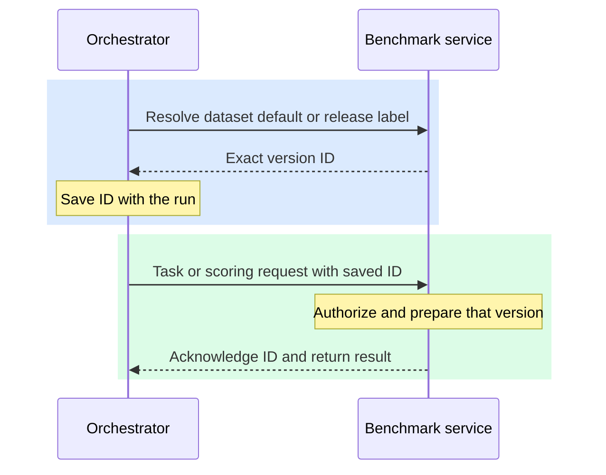

# Dataset versions

A dataset can change under a run: the service ships new tasks or a fixed answer key, and a run that started on one version finishes on another. This page covers the two tools for that: a version label each dataset declares, and pinning one exact version for a whole run.

## Label each dataset's version

Separate from the framework version, a service can declare a semver label for each dataset's content. It's only a label: it records the declared version, and never reads or verifies the data.

- `get_dataset_version(name)` serves it on `GET /version?dataset=` and on the dataset task-list response, and generated lab manifests carry it.
- Bump it like the framework version: major when scores aren't comparable, minor for additive, comparable changes, and patch for fixes that don't change scoring.
- The label comes from a YAML file, not from how `load_datasets()` gets the data. Declare it whether the dataset is a repo-local file or fetched from somewhere else.

To declare labels:

1. Add a `dataset_versions.yaml` that maps each dataset name (the API name a caller passes as `dataset`) to a version. Versions are per dataset, so splits can differ:

   ```yaml
   validation:
     version: 1.0.1
   default:
     version: 1.0.0
   ```

2. Point your service at it:

   ```python
   class MyBenchmark(BenchmarkService):
       dataset_versions_file: ClassVar[Path] = Path(__file__).parent / "dataset_versions.yaml"
   ```

The base `get_dataset_version()` serves the declared versions from startup on, so you don't need to override it. Leave `dataset_versions_file` unset to report no dataset version.

## Pin a version for a whole run

A label tells you which version a service says it has, but it can't stop the default from moving mid-run. Version selection can: the run owner (Valkyrie, say) resolves the default once, saves the exact version ID with the run, and sends it on every later request, retries and final scoring included.

- The feature is optional, and works with local files, a database, or a separate dataset store.
- A version ID is an opaque string. The client stores and sends it without interpreting it.

### Who does what

| Owner | Responsibility |
| --- | --- |
| Run owner | Resolve once before task discovery, save the service URL, dataset name, and exact version ID, and reuse them throughout the run and its retries. |
| Framework | Authorize each request, enter the service's version context, and confirm that an explicitly requested ID was selected. It keeps no run-to-version registry. |
| Service or loader | Keep the data for an ID immutable, select it for the request, and reject unavailable IDs. Choose how many versions to retain. |

- A version covers task identity, order, contents, grading data, and versioned assets. It doesn't freeze evaluator code, model behavior, or the agent's environment.
- The framework never derives a version from arbitrary dataset objects, and an informational label doesn't count as version-selection support.



### Client workflow

A client that needs a fixed version follows this flow. The caller's selector (a release label, say) only feeds resolution, and the exact ID that comes back is what you save and send.

```python
from benchmark_service import BenchmarkServiceClient

async with BenchmarkServiceClient(service_url, headers) as client:
    metadata = await client.version(dataset="validation")
    if not metadata.dataset_version_selection:
        raise RuntimeError("This service does not support dataset version selection")
    selected = await client.resolve_dataset("validation")

# Save selected.dataset and selected.version with the run before dispatching tasks.
async with BenchmarkServiceClient(
    service_url, headers, dataset_version=selected.version.id
) as client:
    tasks = await client.verify_task_ids(None, None, dataset=selected.dataset)
```

- Pass `version="v1.0"` to `resolve_dataset` to pick a fixed release, or leave it out for the service's configured default. There's no `latest` alias.
- A label from `/version` on its own doesn't show that the service supports version selection.
- Keep the dataset name and service URL with the version ID. IDs belong to one service and dataset, and another service may use the same string for different data.
- A client's pin can't change during its lifetime, so create another client for another version.

### Implement the service hooks

- Override `supports_dataset_version_selection(dataset)` and `open_dataset_version(dataset, version)`.
- `open_dataset_version` is an async context manager that yields a `DatasetVersion(id=..., label=...)`. Both fields are required, and `label` can be `None`.
- The framework checks dataset access before entering the context. The context selects and prepares the data, and keeps it available until the operation finishes.
- Task, grading, and scoring methods keep their signatures. They read the selected data through request-local state, such as a `ContextVar` that `get_dataset()` reads.

```python
@asynccontextmanager
async def open_dataset_version(self, dataset, version):
    selected = version or self.default_versions[dataset]
    data = self.immutable_releases[dataset][selected]
    token = self.request_data.set(data)
    try:
        yield DatasetVersion(id=selected, label=selected)
    finally:
        self.request_data.reset(token)
```

- This sketch assumes the service has already loaded its immutable releases and set up a request-local variable.
- A service can keep just one immutable release and still report support: it resolves to that version, accepts its ID, and rejects older ones. It must never substitute its current default for a requested version it doesn't have.

### Keep requests isolated

- Don't replace the shared `self.datasets` during a request, since concurrent requests can select different versions.
- Keep task order, task contents, grading data, and versioned assets fixed for an ID.
- The service or loader owns a version's resources and releases them when its context exits. If preparation uses a worker thread, wait for that worker before releasing resources on cancellation.
- The framework exits the version context when a request or stream completes or raises, and a WebSocket send failure ends forwarding.
- A disconnected client isn't detected while preparation or stream work waits without sending. Services must bound that work, and handle their own cancellation and cleanup.
- Use `HTTPException` to report an unavailable version (404), an incompatible version (409), or a temporary storage failure (503).
- Authorization still applies to a pinned request, because a pin isn't permission to read the data.

### Wire contract

| Operation | Contract |
| --- | --- |
| `GET /version?dataset=validation` | `dataset_version_selection: true` declares support for that dataset. Existing services report false. |
| `POST /resolve-dataset` | Body: `{"dataset":"validation","version":null}`. Returns `{"dataset":"validation","version":{"id":"v1.0","label":"v1.0"}}`. When authentication is enabled, the caller must be authorized for the dataset. |
| Dataset HTTP requests | Send `X-Benchmark-Dataset-Version: v1.0`. Successful responses echo it. The client rejects a missing or different echo. |
| Dataset WebSocket requests | Send the same header. Before benchmark task or grading work, the server emits `{"type":"dataset_version","data":{"id":"v1.0","label":"v1.0"}}`. The client consumes it before exposing progress, checkpoints, or results. |

What the header covers:

- Task verification, retrieval, setup, evaluation, and scoring. `/health` and `/version` stay metadata operations.
- Resolution rejects a version header, since its selector goes in the body.
- A supporting service picks its default independently for each unpinned request.
- An explicit pin on a service without support fails, rather than being ignored.

Errors on pinned WebSocket requests:

- If selection fails, the framework sends `{"type":"error","data":"Dataset version unavailable","status_code":404}` before any version acknowledgement.
- The status is 400 for an invalid or unsupported selection, 404 for an unavailable version, 409 for an incompatible one, and 503 for a temporary storage failure.
- The client raises `BenchmarkServiceError` with that `status_code`, and never retries without the pin. Access denial keeps the existing WebSocket policy close.
- Benchmark-owned `error` chunks keep their plain string payload, with no `status_code`. More chunks (a `result`, even) can follow them.
- The client treats an `error` as a failed operation and closes its socket. The server keeps streaming until it completes or a send fails, and the service owns any work and cleanup in between.

Labels and IDs:

- On a pinned request, the task-list response uses the selected version's display label. The acknowledgement and the HTTP response header carry the exact ID.
- `/version?dataset=...` keeps reporting the service's configured label, which can differ from a saved pin.
- IDs are 1 to 1,024 visible ASCII characters with no whitespace, and display labels are up to 256 Unicode characters.
- Resolution selectors can contain Unicode and spaces, so a service can map a release name to its exact ID.
- Duplicate headers are rejected. Browser deployments must allow and expose `X-Benchmark-Dataset-Version` in their CORS policy.

### Services without version selection

- `dataset_version_selection: false` means the service can't guarantee one exact version across requests. It may still report an informational `dataset_version` label.
- Normal requests without a version header keep working, while resolution and explicit version requests are rejected.
- A run owner that allows unversioned runs should record no enforced version, and show that dataset consistency isn't guaranteed. It must reject an explicit version choice rather than ignore it.
- Don't invent an ID by hashing task IDs or public task content, since the service may grade with data and assets the caller can't see.

### Rollout and limits

- Upgrade every replica before sending pinned traffic. Old framework versions may ignore the header, and although the client catches the missing acknowledgement, an old handler may already have done the work.
- The run owner reuses its saved selection after restarts and retries, so a run fails to recover if a later deployment removed its version.
