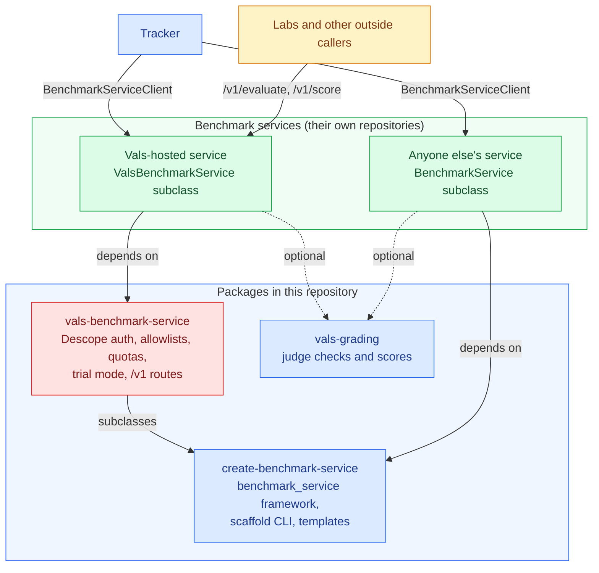

# vals-benchmark-service

This is the Vals AI hosting layer for services built on [create-benchmark-service](../create-benchmark-service/README.md): Descope authentication, tenant access from the catalog or an allowlist, evaluation quotas, trial tenants, and the lab-facing `/v1/*` routes. It's released on its own as `vals-benchmark-service-v<version>` tags.

## Where it fits

The framework knows nothing about Vals tenants, and that's on purpose. This package subclasses its classes and adds the hosted policy on top, so a benchmark plugs into the same `benchmark_service` API whether Vals hosts it or not.



- `ValsBenchmarkService` and `ValsBenchmarkServiceApp` inherit the framework's `BenchmarkService` and `BenchmarkServiceApp`. The framework never imports this package.
- The Tracker reaches hosted services through the same `BenchmarkServiceClient` as any other. Only outside callers use the [lab-facing routes](#lab-facing-v1-routes), and only this layer serves them.
- Hosted deployments set `EVAL_RESUME_BUCKET` and `EVAL_RESUME_PREFIX` for services that opt in to retryable grading.

## Use it in a service

Scaffold the service with `create-benchmark-service`, then depend on both packages at their release tags:

```toml
[project]
dependencies = ["create-benchmark-service[vals-ai]", "vals-benchmark-service"]

[tool.uv.sources]
create-benchmark-service = { git = "https://github.com/vals-ai/Valkyrie.git", subdirectory = "packages/create-benchmark-service", tag = "cbs-v<version>" }
vals-benchmark-service = { git = "https://github.com/vals-ai/Valkyrie.git", subdirectory = "packages/vals-benchmark-service", tag = "vals-benchmark-service-v<version>" }
```

Subclass `ValsBenchmarkService` and serve it with `ValsBenchmarkServiceApp`:

```python
from vals_benchmark_service import ValsBenchmarkService, ValsBenchmarkServiceApp
```

- A service that still imports `benchmark_service.vals`, or carries a generated local `vals_ai/` package, switches to `vals_benchmark_service`. Check the local copy for service-specific changes before deleting it.
- `scripts/migrate_cbs_consumer.py` makes that switch and rewrites the sources. Run `uv lock` in the service afterwards.

## Development

```bash
make install
make lint typecheck test
```

## Lab-facing `/v1` routes

`ValsBenchmarkServiceApp` adds `/v1/evaluate`, `/v1/score`, `/v1/datasets/{dataset}/tasks`, and `/v1/submissions/upload-url`, which the public `BenchmarkServiceApp` doesn't register. Every mode scores with `calculate_final_score`, and the service's `eval_mode` decides how `/v1/evaluate` grades:

| `eval_mode` | How `/v1/evaluate` grades |
| --- | --- |
| `TEXT` (default) | `evaluate_response` on the inline text |
| `IN_PROCESS_ARTIFACT` | `evaluate_artifact` on the admitted upload's bytes |
| `SANDBOX` | `evaluate_instance` in a fresh, network-isolated grading sandbox |

- `/v1/evaluate` carries the run, task, and attempt IDs in its body, where the internal routes use `X-Vals-*` headers.
- On services from the Vals template, the `X-Benchmark-Dataset-Version` pin also covers `/v1` evaluation, scoring, task listing, and upload preparation.

### In-process artifact evaluation

- Declare `eval_mode = EvalMode.IN_PROCESS_ARTIFACT`, list only the artifact schema IDs you accept, and implement `evaluate_artifact(task_id, schema_id, artifact, dataset)`.
- Before calling it, the framework validates the tenant, dataset, task, schema, and upload key, records the artifact's size and ETag, and downloads that exact version.
- The hook gets bytes, never an object key, bucket, or tenant credential.
- These deployments need `SUBMISSION_ARTIFACT_BUCKET` and `AWS_REGION`.
- Artifact admission and evaluation share the normal grading concurrency and duplicate-request limits. Text evaluation and WebSocket resume keep their own routes and stream contracts.

### Sandbox evaluation

Benchmarks that have to run the submission to grade it (a test suite, a proof check) declare `eval_mode = EvalMode.SANDBOX`, list the exact payload schemas they accept, and implement `prepare_grading_sandbox(sandbox, submission)`. `POST /v1/evaluate` then provisions a fresh, network-isolated sandbox, puts the submission in it, runs `evaluate_instance`, and deletes the sandbox.

- A submission comes inline (`payload.type == "text"`) or by reference (`payload.type == "artifact"`, with `payload.data` holding the key from `/v1/submissions/upload-url`).
- For an artifact, the route reserves grading capacity, then records an immutable `artifact_reference` (key, size, and ETag) before provisioning a sandbox.
- That reference pins the download to the admitted object version, which lands at `submission.sandbox_path` before the hook runs. Admission stays held through bounded sandbox cleanup.
- The hook receives a `TextGradingSubmission` or `ArtifactGradingSubmission` with the payload schema and its `text` or `artifact_reference` field, so it never has to guess the submission type.

Grading sandboxes:

- `GRADING_SANDBOX_PROVIDER` picks the provider: `daytona` (the default), `daytona_v2`, `modal`, or `docker`.
- Daytona reads `DAYTONA_API_KEY`, `DAYTONA_API_URL`, and `DAYTONA_TARGET`, and an optional `DAYTONA_ORGANIZATION_ID` turns on organization-scoped capacity admission. Modal reads `MODAL_TOKEN_ID` and `MODAL_TOKEN_SECRET`.
- Missing server configuration fails at startup.
- The task's `eval_sandbox` can override the grading source, image-backed resources, timeout, and network policy. `/v1` grading uses the sandbox it builds from that spec.
- Keep evaluator secrets in private deployment config or server code. They're never returned in `RetrieveTaskResponse` or saved with a submission.
- Grading sandboxes use an image or snapshot, never `ComposeSource`. A task whose generation uses `ComposeSource` must set `eval_sandbox.source` to an image or snapshot, since grading doesn't start Docker and Compose in a fresh sandbox.

Time and capacity limits:

| Setting | Default | What it bounds |
| --- | --- | --- |
| Preparation (fixed) | 600 seconds | Task retrieval, sandbox creation, submission materialization, and the setup hook, together |
| `eval_sandbox.timeout_s` | 1800 seconds | `evaluate_instance`, starting right before it runs |
| `GRADING_MAX_CONCURRENCY` | 4 | Active grades per service process |
| `GRADING_MAX_QUEUED` | Same as concurrency | Queued grades |
| `GRADING_MAX_ADMITTED_PER_TENANT` | Same as concurrency | Admitted work per tenant |
| `GRADING_QUEUE_TIMEOUT_S` | 30 | Seconds a grade can wait in the queue before a 429 |

- Sandbox teardown has its own bound, and duplicate `(tenant, run_id, task_id)` requests return 409.
- Generator cleanup must not catch and suppress `asyncio.CancelledError`, since Python can't force-stop in-process code that ignores cancellation.

### `POST /v1/evaluate`

Grades one task. Request:

```json
{
  "run_id": "external-run-123",
  "task_id": "01-011",
  "dataset": "validation",
  "payload": {"type": "text", "schema": "fabv2.text.v1", "data": "..."},
  "versions": {"runner": "0.0.10-a1b2c3d"}
}
```

Response:

```json
{
  "run_id": "external-run-123",
  "task_id": "01-011",
  "status": "evaluated",
  "evaluator_version": "0.0.2",
  "result": {"pass_percentage": 0.83, "...": "..."},
  "errors": []
}
```

- `status` is one of `evaluated`, `did_not_complete`, `generation_error`, or `error`.
- `result` is the benchmark's JSON value: what `evaluate_response` returned in text mode, or the final result chunk from `evaluate_instance` in sandbox mode.
- `payload.type` is `"text"` for inline submissions. `"artifact"` (artifact-grading benchmarks only) carries the uploaded object key in `data`.

### `POST /v1/score`

Aggregates across a run. Request and response:

```text
request:  {run_id, dataset, evaluation_results: {task_id: {"status": "evaluated", "result": {...}} | {"status": "did_not_complete"} | null}}
response: {run_id, tasks_evaluated, final_score, metadata}
```

- Before calling `calculate_final_score`, the framework unwraps each item to the grader payload, the same shape the internal `/final-score/` route passes. A benchmark implements one hook against one shape, whichever route the caller used.
- An item whose `status` isn't `evaluated` becomes `null`, as does an item sent as `null`. Both mean the task reached no verdict.
- `errors` aren't forwarded, since they describe the attempt rather than its result.

### `POST /v1/submissions/upload-url`

Mints a presigned S3 PUT URL for a submission artifact, such as an agent workspace tarball that grading later rehydrates.

- Request `{run_id, task_id, dataset?, filename}`. Each field must be a plain key segment (`[A-Za-z0-9][A-Za-z0-9._-]{0,127}`), and `task_id` must exist in the dataset.
- Response `{key, url, expires_in}`. The caller PUTs the bytes to `url`, then reports `key` as the task's generation output.
- Deployments serving uploads need the `vals-ai` extra, `SUBMISSION_ARTIFACT_BUCKET`, and `AWS_REGION` (presigned URLs are signed per region). Without the bucket the route returns 503, and a bucket without a region fails at startup.
- Server-side reads default to a 64 MiB limit. Set `SUBMISSION_ARTIFACT_MAX_DOWNLOAD_BYTES` to a smaller positive count for a tighter bound, and note that an invalid limit fails at startup.
- Trial tenants can't use this route.
- The service role needs `s3:PutObject` and `s3:GetObject` on `arn:aws:s3:::BUCKET/submission-artifacts/*`, plus `s3:ListBucket` on `arn:aws:s3:::BUCKET` limited to `submission-artifacts/*`.
- The list permission matters because [S3 returns 404 for a missing object only to callers with `s3:ListBucket`](https://docs.aws.amazon.com/AmazonS3/latest/API/API_HeadObject.html#API_HeadObject_Permissions), and 403 otherwise. The framework leaves a 403 as a permission failure rather than reporting the object missing.

### `GET /v1/datasets/{dataset}/tasks`

Returns the dataset's task list, behind the same tenant authentication and `check_dataset_access()` gate as the rest of `/v1/*`:

```json
{
  "dataset": "validation",
  "dataset_version": "2026-06-10",
  "tasks": [
    {"id": "01-011", "question": "...", "timeout": null},
    {"id": "01-012", "question": "...", "timeout": 600}
  ]
}
```

| Status | When |
| --- | --- |
| 403 | Authentication is required and the caller has no allowed tenant identity for the dataset |
| 404 | Access is allowed, but `load_datasets()` doesn't load the dataset |
| 501 | The benchmark hasn't implemented `list_tasks` |

- The base `list_tasks` doesn't infer a public task shape, because loaded task objects often hold evaluator-only data (`answer`, `checks`, rubrics, grader config). Benchmarks map their tasks to `V1Task(id, question, timeout, ...)` explicitly.
- `V1Task` allows extras, so a benchmark can add per-task fields (SWE-bench's `repo` and `base_commit`, say). Document them in the benchmark's README, and validate them on the runner side with a typed `Task` subclass.

### Trial mode

- A tenant with `trial_mode: true` in its allowlist entry gets score-only responses on `/v1/evaluate` and `/v1/score`.
- A benchmark that allows trials implements `project_trial_result(result)`, returning the audited per-task fields trial callers may see and resubmit to `/v1/score`. Include every field `calculate_final_score` needs.
- For trial tenants, `/v1/evaluate` drops `evaluator_version` and error text (the error count survives as generic `"error"` entries). `/v1/score` empties `metadata` and keeps `final_score` and `tasks_evaluated`.
- The sanitizer builds fresh responses from allowlisted fields, so fields added later don't leak to trial callers by default.
- Trial tenants may use only `/v1/datasets`, `/resolve-dataset`, `/v1/evaluate`, `/v1/score`, and `GET /v1/datasets/{dataset}/tasks`. Everything else (other `/v1/*`, `/evaluate-response/`, `/final-score/`, and `/ws/*`) returns 403.
- They can list and resolve the datasets they may access, and resolving consumes no evaluation quota.
- Their dataset task list is cut to `id`, `question`, and `timeout`, even when the benchmark's `V1Task` has extras.
- Unhandled server errors return a generic `{"detail": "Internal server error"}` 500 with no traceback, for every caller.

## Authentication

The `/v1/*` routes take requests without credentials by default. Set `AUTH_REQUIRED=true` to require Descope authentication and the tenant and dataset allowlists below.

- With authentication required, set `DESCOPE_PROJECT_ID` and a tenant and dataset allowlist.
- Requests send a valid Descope access key in `X-Descope-Api-Key`. The key must be scoped to exactly one Descope tenant, and that tenant must be in the service allowlist.
- A boolean `check_auth()` override can't grant `/v1/*` access without a tenant identity.
- Catalog access, quotas, and trial restrictions apply only when authentication is required.

### Where the allowlist comes from

The first configured source wins:

1. `BENCHMARK_CATALOG_API_URL` plus `SERVICE_NAME`: the service-specific catalog API returns the tenant's policy. Positive policies are cached for 300 seconds, an unknown tenant is refreshed immediately, and an unavailable API or invalid data fails closed.
2. `DESCOPE_TENANT_ALLOWLIST_JSON`: a JSON payload, kept for the staged production rollout.
3. `DESCOPE_ALLOWLIST_PATH`: a local YAML file, handy for development.
4. Nothing configured: startup works, but Descope-authenticated requests fail closed.

To turn on catalog mode, set both variables in the service container:

```text
BENCHMARK_CATALOG_API_URL=https://<catalog-api-host>
SERVICE_NAME=<registered-service-name>
```

- Catalog requests send the authenticated `x-descope-api-key` header, and the service never reads the catalog bucket directly. Leave `BENCHMARK_CATALOG_API_URL` unset to keep the JSON or YAML behavior.
- Lookups retry connection failures, timeouts, HTTP 408 and 429, and server errors, up to three attempts with randomized backoff. The total deadline is five seconds, with at most two per attempt.
- Authorization denials and malformed policies aren't retried. Exhausted retries deny access, without reusing an expired policy or caching the failure.

An example allowlist:

```yaml
tenants:
  acme-corp:
    datasets:
      - validation
    evaluation_quota:
      limit: 2500
      period: week
  vals-internal:
    datasets:
      - default
      - validation
      - test
```

### Errors

- With authentication required, a malformed configured allowlist fails app startup.
- Unknown tenants get `401 Unauthorized`. A known tenant asking for a dataset outside its allowlist gets `403 Dataset not allowed`, and WebSocket routes close with code `1008`.
- The tenant ID `"unauthenticated"` is reserved for boolean auth and local development, and is rejected as a Descope tenant.

## Evaluation quotas

Add `evaluation_quota` to a tenant entry to cap its evaluation requests per `day`, `week`, `month`, or `year`. Periods follow UTC calendar boundaries (days at 00:00, weeks on Monday, months on the first, years on January 1), and changing a tenant's period starts a separate counter.

- `POST /v1/evaluate`, `POST /evaluate-response/`, `/ws/evaluate-response`, and `/ws/evaluate-instance` share one quota. Task setup, task retrieval, and score aggregation don't count.
- Authentication, request parsing, dataset authorization, and payload compatibility are all checked before a request counts, and so are the duplicate and immediate-capacity checks for admitted grading.
- An accepted request then uses quota before waiting for a grading slot or touching submission storage. Once counted, it stays counted even if evaluation or a later step fails.
- Past the limit, HTTP routes return 429 with `Retry-After`, and WebSocket routes close with `1008`.

### Counter storage

- Quota deployments set a stable, non-empty `SERVICE_NAME`, and `EVALUATION_QUOTA_TABLE_NAME` pointing at a DynamoDB table with string partition key `quota_key` and TTL attribute `expires_at`.
- `SERVICE_NAME` keeps each service's counters apart in a shared table, so it must not change during a quota period. The task role needs `dynamodb:UpdateItem` on the table.
- Counter updates are atomic across processes, and aren't retried because increments aren't idempotent.
- A write that reaches DynamoDB counts even if its response is lost. So an ambiguous storage failure can return HTTP 503 (or WebSocket close `1011`) after using one unit.
- Internal AWS errors are logged, not returned to the caller.
- Missing counter configuration fails startup rather than silently turning enforcement off.
