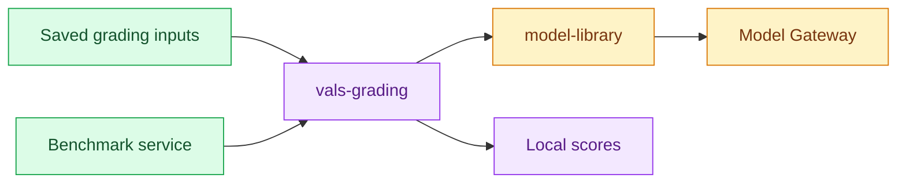

# vals-grading

vals-grading grades saved benchmark responses with judge-model checks, using your own prompts and the Model Gateway. It returns per-check results and a weighted score without contacting the Vals platform, and doesn't depend on [create-benchmark-service](../create-benchmark-service/README.md).



## Install

From the repository root, enter the grading package and install the Gateway integration:

```bash
cd packages/vals-grading
uv sync --extra gateway
```

Set `MODEL_GATEWAY_URL`, `MODEL_GATEWAY_API_KEY`, and `IDENTITY` before starting Python:

- `IDENTITY` is a JSON object that names the service in Gateway usage records, such as `{"service":"my-benchmark"}`.
- The judge sends it with `agent_name` set to `"grader"`, so usage records keep judge spend apart from the agent's.
- The run, task, and attempt come from the grading token the host binds ([create-benchmark-service binds one per evaluation](../create-benchmark-service/docs/GRADING.md#grading-credentials)). Outside one, usage is attributed to no run.

Then run the example against the Gateway:

```bash
uv run --extra gateway python examples/grade_saved_response.py
```

- This sends a real model request, so it costs provider money.
- The example reads a synthetic grading case and a saved response from local JSON files. Swap those for your benchmark's inputs.
- Keep judge prompts and reference context in service-private storage.

## Use it in a service

```python
from pathlib import Path

from vals_grading import CheckJudge, GradingCase
from vals_grading.gateway import GatewayJudgeModel

case = GradingCase.model_validate_json(Path("case.json").read_text())
judge = CheckJudge(GatewayJudgeModel("anthropic/claude-opus-4-7"))
result = await judge.grade_test(case, "candidate response", {})
score = result.pass_percentage_with_weight
```

- A grading case holds a test ID, input text, JSON context, and checks. Each check has an operator name, prompt, criterion, and severity weight.
- Every field is required, and unknown fields fail validation. `examples/case.json` shows the full format.
- Pin the package version together with your grading inputs and model choice.

### Install from Git

Pin the package subdirectory at a commit you've reviewed:

```bash
uv add "vals-grading[gateway] @ git+https://github.com/vals-ai/Valkyrie.git@<commit>#subdirectory=packages/vals-grading"
```

- Replace `<commit>` with the full commit SHA. This installs only the grading distribution and the dependencies you selected.
- The version comes from this directory's `pyproject.toml` (starting at `0.1.0`), independent of CBS tags. The public sync tags each released version as `vals-grading-v<version>`.

### Dependencies

- The core package depends only on Pydantic. The `gateway` extra adds the public `model-library`.
- `vals_grading.protocols.JudgeModel` defines the two methods another model implementation needs. `GatewayJudgeModel` is the reference implementation, and needs the Gateway configuration.

## Convert existing Vals suites

Install the `vals` extra to convert an already loaded SDK suite:

```python
from vals_grading.adapters.vals import export_suite, to_test_result

cases = export_suite(suite, operators)
result = await judge.grade_test(cases[test.id], transcript, output_context)
sdk_result = to_test_result(result, test, transcript, output_context, metadata)
```

- `operators` maps operator names to exported `CustomOperatorPrompt` values.
- Export cases while preparing the dataset, and save each with `model_dump_json()`. Loading those saved cases in the service keeps platform access out of grading startup.
- The adapter makes no network calls. Loading suites from the platform and uploading results stay with the caller.
- For building and connecting the service itself, see Valkyrie's [benchmark guides](https://docs.valkyrie.vals.ai/benchmarks/convert-a-benchmark).

## Grading behavior

This implements the platform's binary custom checks, ported from platform revision `d63fdbd` and create-benchmark-service commit `27ffd6e6`. Where it differs, it's stricter.

### What matches the platform

- Prompt replacement order, two fallback requests, per-test concurrency of ten, and severity-weighted scoring.
- Nested context substitutions keep the platform's outer braces.
- Negative severity weights penalize failing checks.
- An empty rubric list is a binary check, as on the platform.

### Where it's stricter

- It rejects nonbinary JSON scores, and limits final requery scores to zero or one.
- Results carry their saved grading case, and SDK conversion rejects changes to the test inputs, context, checks, or weights.
- The adapter rejects built-in operators, global checks, golden outputs, rubrics, conditional checks, extractors, and examples.
- The engine rejects file placeholders, and full input contexts over 50,000 tokens, before grading.
- It strips `trajectory_atif` from the output context before rendering prompts.
- Call `require_gradeable(case)` at startup to catch unsupported prompts early. `grade_test` repeats that validation on its own copy of the input.

### Failures and confidence

- A model exception becomes a failed check with `eval_error=true`.
- Cancellation propagates to the caller instead of producing a score.
- Confidence evaluation is off. Successful checks get confidence `0.5`, and errored checks `0`.
- So the low-confidence percentage is `1` when any check errored and `0` otherwise. It isn't the fraction of checks that failed.

## Development

Run these from `packages/vals-grading`:

```bash
make install
make test
make lint
make typecheck
make build
```

- The package has its own lockfile and CI workflow (`vals-grading.yaml`). Publishing it to PyPI needs separate release setup and approval.
